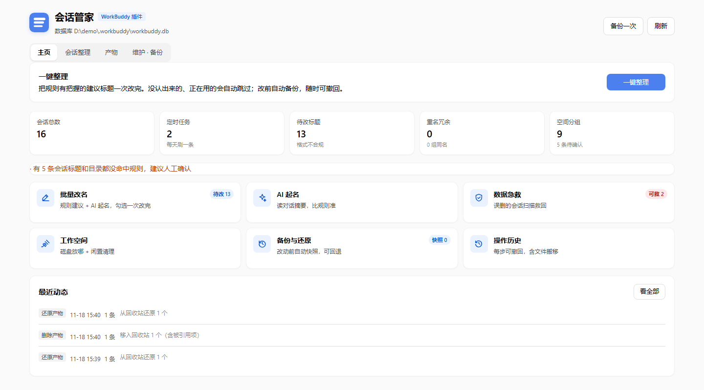
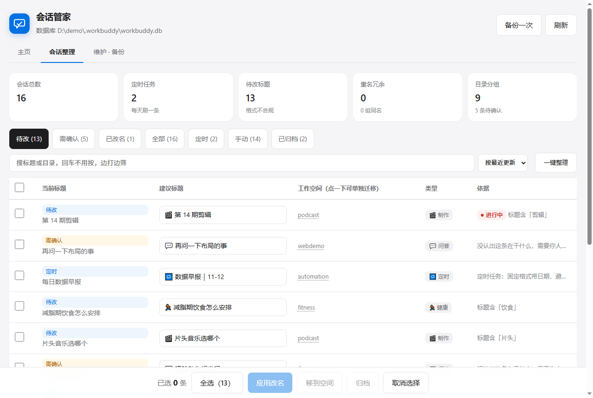
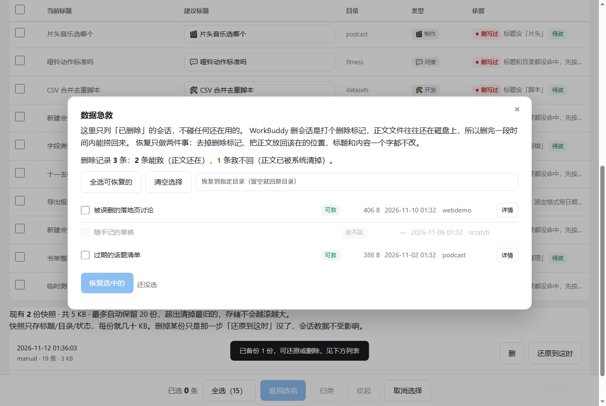
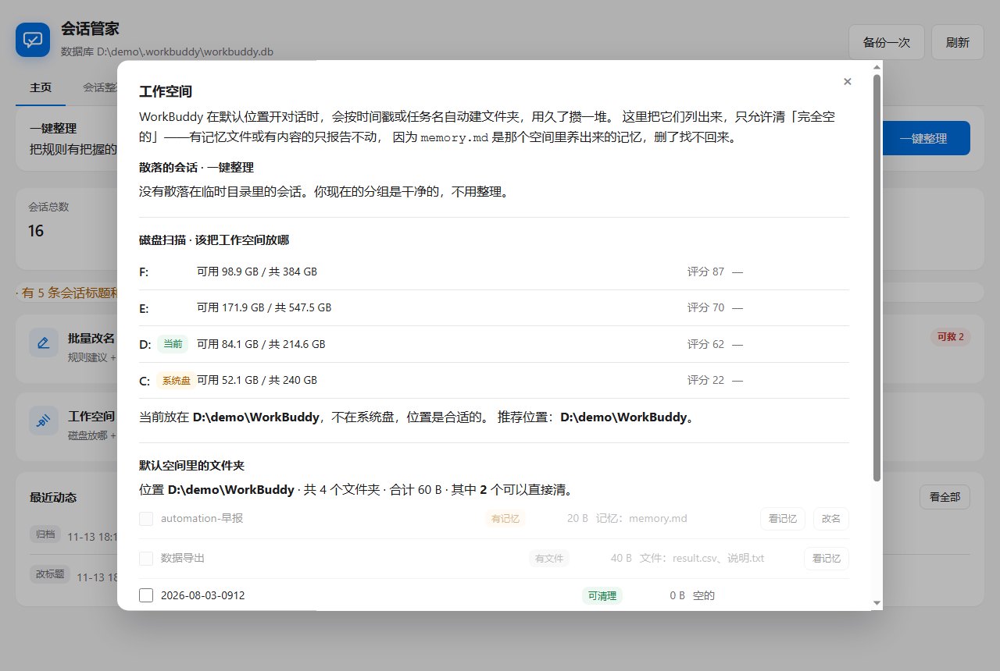
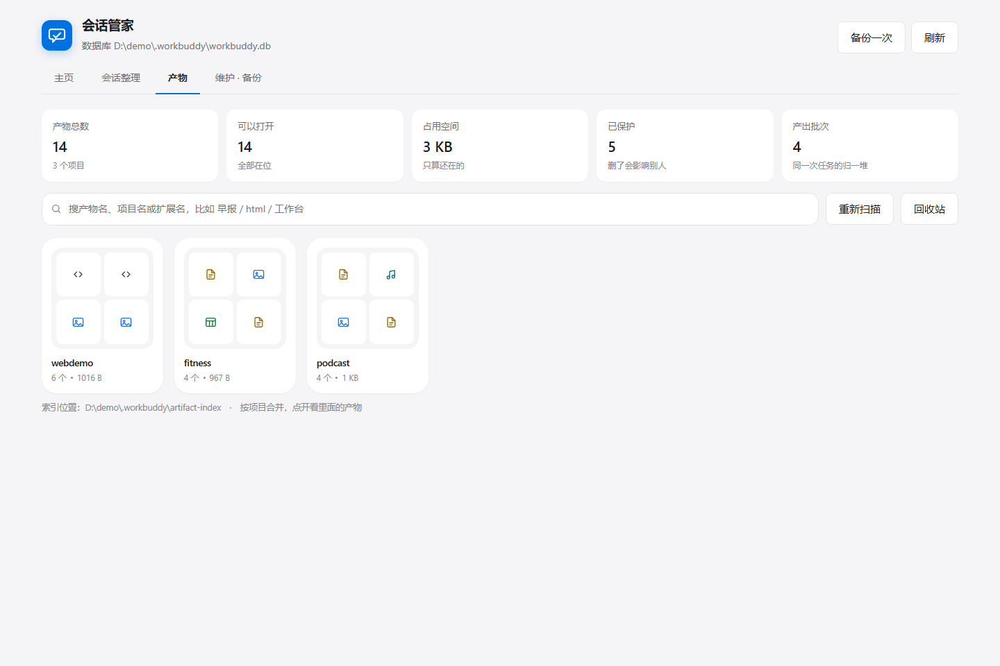
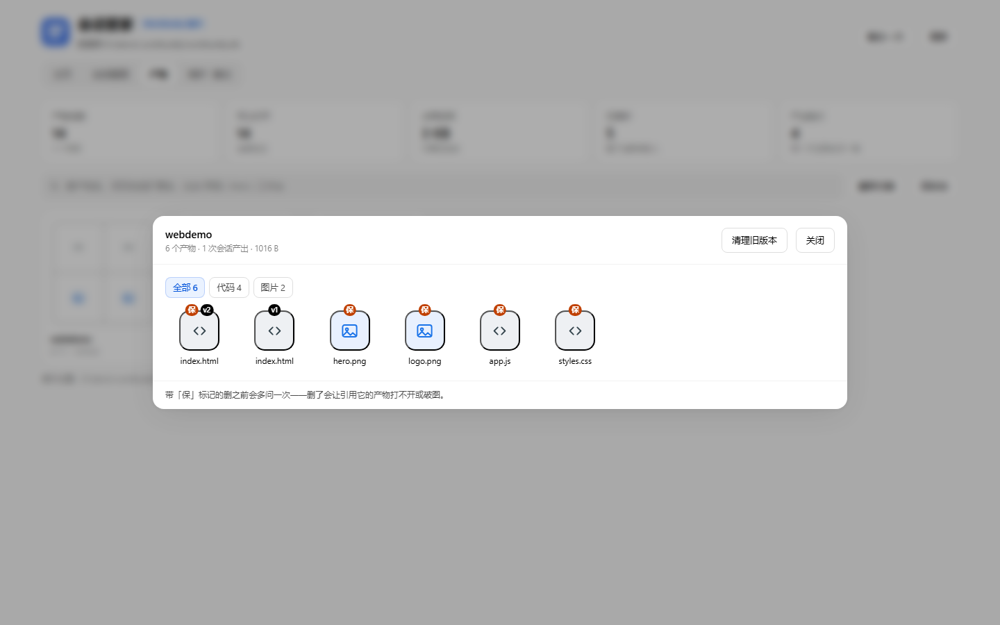
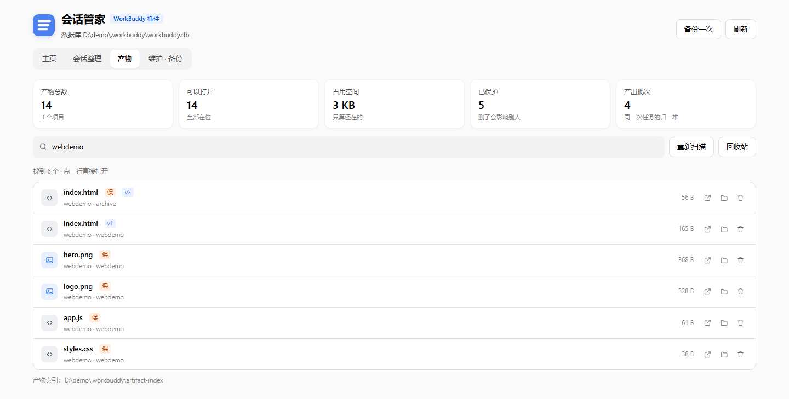
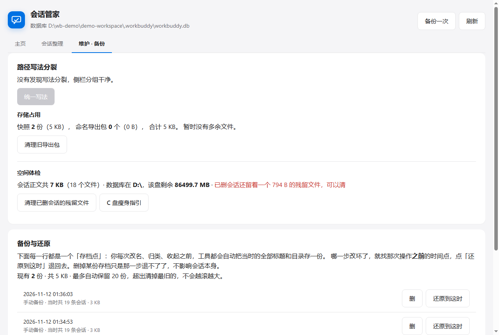
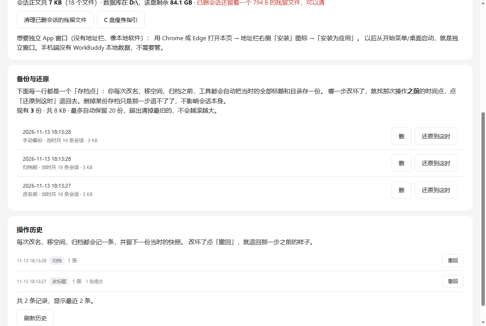

<p align="center">
  
</p>

# WorkBuddy 会话整理工具 · 使用说明

一句话：把 WorkBuddy 侧栏里那一堆重名、没归位、看不出在干嘛的会话，一次性整理干净。

## 为什么会有这个东西

WorkBuddy 我用了大半年，侧栏里堆了一百多条会话，一大半叫「新建会话 2026-08-11 2030」，还有一堆「再问一下」。想找上个月那个项目的对话，只能一条条点开看。

忍了很久。后来想明白这不是 WorkBuddy 的问题，是我自己用得随便。但一条条手动改，又实在改不动。

于是就有了这个工具。它做的事很土：一次改几十条标题、把会话挪回该在的文件夹、把不用的收起来。没有花活。

代码是我一边问 AI 一边写的。不是科班出身，很多写法谈不上优雅，能跑、我自己每天在用、没丢过数据——这就是它的全部水平。

至于有没有人需要它，我不知道。如果你也刚好被同一件事烦到，拿去用。

第一次把东西放出来给别人看，说实话有点紧张。

> **第一次用、只想赶紧收拾侧栏的**：看 [给第一次用的人：怎么用](docs/使用说明_小白版.md)。那份不讲原理，只讲点哪里，遇到问题怎么办。
> 下面这份讲的是原理、边界和每处改动的实际影响，适合想弄清楚「它到底动了什么」的人。

它不跑在 WorkBuddy 里面，而是从外面读 WorkBuddy 的数据库。所以它能干对话里干不了的事：一次改几十上百条。

**你的数据不出本机。** 工具只读写本机的数据库和文件，没有任何遥测、没有联网上报。
唯一的网络请求是你主动配置 AI 命名 API 之后发给模型服务商的那部分。不用 AI 命名，它就完全离线。

## 授权与使用边界

- 开源、可学习、可模仿、可优化、可二次开发——欢迎借鉴，我本人也是对标模仿起家的。
- **不允许**：直接拿去卖钱（打包出售、付费分发、SaaS 收费）。商用授权另行协商。
- 详见 [LICENSE](LICENSE) 附加条款。

## 界面预览（演示数据）

打开先看到**主页**：数据概览、功能入口（带状态角标）、最近动态。不是一上来就甩你一张表。



「会话整理」才是干活的地方：统计、筛选、建议标题、批量操作。



数据急救（误删恢复）、工作空间清理：





「产物」页把散在各处的产出按项目合并成文件夹，封面是里面 4 个代表文件：



点开一个文件夹，里面每个产物是一个带图标的格子。带「保」的删之前会多问一次，「v2」表示同名文件里的第几版：



找东西用搜索，结果按列表排，点一行直接打开：



> 这些会话全是演示数据。你可以用 `python make_demo_env.py` 生成同款环境自己跑一遍。
> 双击 `启动.bat` 会优先以浏览器「应用窗口」模式打开（没有地址栏和标签页，观感就是桌面应用）。

### 界面为什么长这样

这工具是跑在 WorkBuddy 旁边的，界面要是另一个风格，一眼就看得出是外挂。所以视觉参数直接从 WorkBuddy 自己的设计变量里取，不是估的：

| 项 | 取值 | 来源 |
|---|---|---|
| 主色 | `#4d80ef` | `brand-blue`（浅色主题） |
| 页面底 / 卡片 | `#fafafa` / `#fff` | `gray-1` / `white-100` |
| 内嵌区块 | `#f2f2f2` | `gray-3` |
| 边框 | `#dedede` | `border-solid` |
| 正文 | 14px | `font-size-5`，WorkBuddy 的正文档位 |
| 圆角 | 8 / 12 / 16 | `radius-lg` / `xl` / `2xl` |
| 卡片阴影 | `0 1px 2px #0000000a` | `shadow-card` |

几个刻意的选择：

- **导航用分段控件，不用下划线选项卡。** 下划线是网页的语汇，插件里一眼就能看出不是同一个东西。
- **卡片悬停只变底色和描边，不做整块上浮。** 上浮会让整页看起来在抖。
- **筛选项选中用主色软底，不用黑底白字。** 黑块和主按钮一个重量，界面上就出现了两个「主操作」。
- **输入框默认浅底无框，聚焦才浮出白面。** 少一圈框线，视线更集中在内容上。

---

## 一、你能用它做什么

| 能力 | 说明 | 风险 |
|---|---|---|
| 批量改标题 | 一次列出全部会话，按规则给建议名，勾选后一次改完 | 低，只改标题字段 |
| 逐条微调 | 建议名不满意，直接在输入框里改 | 低 |
| 让 AI 起名 | 接 API 一键命名，或者导出摘要手动交给别的 AI | 低，只看不改 |
| 移到空间（搬目录） | 把临时目录里的会话挪进项目目录，**每条可各自指定目标**，搬前先出清单让你确认 | 中，会动磁盘文件 |
| 左侧栏「最近 / 分组」 | 跟 WorkBuddy 新版侧栏对齐：按空间分组浏览，另有「最近 7 天」入口，点一下就筛出那一组 | 无，只看不动 |
| 归档 / 取消归档 | 不用的会话从侧栏隐藏，数据完整保留，随时能放回来 | 低，改状态字段 |
| 数据急救 | 会话被误删（软删除）后能扫描出来：正文还在的直接恢复，可救回原来的位置或指定新目录 | 低，只去掉删除标记、不覆盖任何文件 |
| 闲置空间清理 | 列出默认工作空间里的文件夹，标注「有记忆 / 有文件 / 可清理」，只允许清完全空的；有 memory.md 的强制保护 | 低，只删空文件夹 |
| 磁盘扫描 | 扫描各盘剩余空间和现有工作空间位置，推荐该把工作空间放哪，不乱指到程序目录 | 无 |
| 散落会话整理 | 找出散落在临时目录的会话，一键归位 | 中，会动磁盘文件 |
| 备份管理 | 每次写之前自动存快照；面板里能看现有几份、占多少，可手动删（删前弹确认）。最多自动保留 50 份，不会滚大 | 低 |
| 统一路径写法 | 同一目录被写成两种样子导致侧栏裂开时，一次合回去 | 低，只改字符串 |
| 存储清理 | 清掉旧的命名导出包，避免越攒越多 | 低 |
| 搜索 | 按标题、目录、判断依据边打边筛，97 条里找一条不用翻页 | 低 |
| **产物合集** | 把 WorkBuddy 产出的所有文件按项目合并成文件夹，像手机主屏幕那样一格格摆开，点图标直接打开 | 无，只看不动 |
| **产物搜索** | 两千多个产物里按文件名、项目、扩展名、路径边打边找，点一行就打开 | 无 |
| **产物回收站** | 删产物只是移到回收站，随时还原；还原回原位置，不覆盖已有文件 | 低，可还原 |
| **依赖保护** | 自动辨认被别的产物引用的文件（比如图标被页面引用），删之前拦下来并说清会让谁失效 | 无，只做提示 |
| 操作历史与撤回 | 每次改动记一条，能退回那一步之前；撤回移到空间会把文件一起搬回去 | 低，撤回前自动备份 |
| 标记「进行中」 | 正在使用的会话标红，搬不动，防止把正在写的文件搬走 | 低 |
| 命令行 | `wbact.py`，不开浏览器也能改，适合在对话里直接调用 | 低，同工具 |

它**不做**的事：不删会话、不改对话内容、不动模型和用量记录。

---

## 二、怎么用

本仓库提供两种跑法，功能完全一样：

- **双击 `wb-manager.exe`**（推荐）——不用装 Python，不弹命令行窗口。exe 在本仓库的 [Releases](https://github.com/LL887526/wb-manager/releases) 页下载
- 双击 `启动.bat` 用源码跑——需要 Python 3.9+

两种打开后都是独立应用窗口（没有地址栏和标签页），**关掉窗口进程就退出**，不在后台常驻。

| 能改几条 | 要不要装东西 | 适合 |
|---|---|---|
| 全部，一次几十条 | 不用装，双击就能跑 | 一次性收拾历史烂账，日常批量维护 |

> 作者另有一个装在 WorkBuddy 技能目录里的对话内版本（在对话里说一句话就能归位当前会话），那个是作者自用形态，不在本仓库范围内。两者读同一份数据，互不冲突。

---

## 三、装之前要有什么

| 要求 | 说明 |
|---|---|
| 系统 | Windows 10 / 11（**仅支持 Windows**，macOS / Linux 不支持，见文末说明） |
| Python | **只有用源码跑才需要**（3.9 以上）。双击 `wb-manager.exe` 不需要装任何东西 |
| WorkBuddy | 装过并至少用过一次，本地有数据 |
| 权限 | 能读写自己的用户目录 |

用源码跑的话，没有 Python 就去 python.org 下 Windows 安装包，安装时勾上 `Add Python to PATH`。

---

## 四、怎么跑这个工具

### 方式 A：双击 `wb-manager.exe`（推荐）

从 [Releases](https://github.com/LL887526/wb-manager/releases) 页下载 `wb-manager.exe`，放到一个自己找得到的位置（比如桌面新建一个文件夹），双击就行，不弹命令行窗口，一两秒后出现一个独立应用窗口。

| 行为 | 表现 |
|---|---|
| 打开 | 双击图标，出现无地址栏的独立窗口，看起来就是桌面软件 |
| 关闭 | **直接关窗口**，几秒后后台进程自动退出，任务管理器里干干净净 |
| 再打开 | 再双击一次即可（不慢，也不会有残留进程） |
| 重复点击 | 已经开着的时候再双击，只会把窗口唤出来，不会起第二个 |
| 数据在哪 | 配置、备份、历史都在 exe 同目录。整个文件夹拷到别的电脑就是完整迁移 |

**别把 exe 放进 `C:\Program Files` 这类要管理员权限的目录。** 配置、备份、历史都写在 exe 旁边，写不进去工具会弹框提醒你换个位置（而不是双击没反应）。

第一次用可以双击 `安装到桌面.bat`，它会在桌面建一个带图标的快捷方式（只做这一次，以后直接点桌面图标）。桌面被挪到 D 盘之类的也能找到真实位置。

这个脚本**不依赖 PowerShell**。早期版本靠 powershell 调 COM 建快捷方式，但部分机器上安全策略会直接拦掉 COM 实例化，脚本一行没执行就退出，表现就是「双击了，桌面什么也没多」。现在改成由 exe 自己建。

桌面上的名字是 **「会话管家」**，图标取自程序目录里的一个独立 `.ico`，不是从 exe 里读。原因是 Windows 按 exe 路径缓存图标，换了 exe 内的图标之后桌面常常还显示旧的；独立文件带内容哈希，改了图标文件名就变，必然生效。

双击没反应的话，直接跑一次这条，会弹框告诉你结果：

```
wb-manager.exe --install-shortcut
```

### 方式 B：源码运行（需要 Python）

双击 `启动.bat`。

会弹一个黑色命令行窗口，显示类似：

```
[db] 连接正常，98 条会话
wb-manager 已启动：http://127.0.0.1:8765/
数据库：C:\Users\你的名字\.workbuddy\workbuddy.db  （来源：用户目录 ~/.workbuddy）
按 Ctrl+C 停止
```

浏览器会自动打开。窗口别关，关了服务就停了。

### 第二步：先备份

进去先点右上角「备份一次」。虽然每次写之前都会自动备份，但多一份不吃亏。

### 第三步：看建议，改不合适的

默认列出的是「待改」的会话，每条有两列：

- **当前标题**：WorkBuddy 里现在的名字
- **建议标题**：工具算出来的新名字，可以直接编辑

觉得没问题就勾选，点底部「应用改名」。想全选就点表头的勾选框。

### 第四步：回 WorkBuddy 看效果

切到 WorkBuddy，点一下别的会话再点回来，或者切换一下侧栏分组，标题就刷新了。

WorkBuddy 不监听外部改库，不会自动重绘，所以要手动点一下。

---

## 五、归档（最干净的一种「收起来」）

工作区用久了，侧栏里全是半年前的会话。归档就是把这些会话从侧栏藏起来，但一条数据都不删。

1. 勾选要归档的会话（可多选）。
2. 点底部「归档」，看清提示后确认。
3. **重启 WorkBuddy**，这些会话就从侧栏消失了。
4. 想找回来：点筛选栏的「已归档」，勾上，点「取消归档」，再重启一次。

### 为什么归档反而更安全

WorkBuddy 自己有一段「保留策略」清理逻辑，会把放太久的会话删掉。它的代码是这样的：

```js
if (this.isArchived(e)) { o.archivedSkipped += 1; continue; }   // 归档的跳过
if (!(e.deletedAt != null || e.createdAt < r) && ...) {          // 其他的进删除候选
    await storage.deleteSession(e.id)
}
```

**归档的会被明确跳过，普通会话反而可能被清。** 所以归档不只是「收起来」，还是「保护起来」。

### 一个绝对不能用错的字段

`sessions` 表里有个 `deleted_at`，看着像「软删除」，其实**碰不得**：上面那段代码里
`deletedAt != null` 正是删除候选的条件之一，填了它等于把会话送进待删队列。

本工具只写 `status`，从不碰 `deleted_at`。

### 为什么必须重启

WorkBuddy 不监听外部改库。改完它不会自己刷新，重启才能看到效果。这是宿主的限制，
不是工具没做完。

---

## 六、移到空间与维护（这两个动作要看清再做）
### 移到空间

侧栏分组按「会话存在哪个目录」来分。想让会话归到某个项目下，就得把它所在的目录改到那儿。

1. 勾选要搬的会话（底部「全选」可一次全选当前列表）。
2. 点底部「移到空间」，面板会列出你选的每一条，**每条一个下拉框选目标目录**。
3. 想批量：点上面任一个目录标签，所有行一次设成它；再单独改个别行。手输目录也行，输完自动套用。
4. 点「检查」。**这一步只算不动**，会列出每条会话：从哪搬到哪、正文文件多大、能不能搬。标「跳过」的不会被处理。
5. 看清清单，点「确认搬运」，再点一次确认框。

「这几条去 A、那几条去 B」就是在第 3 步做的：先批量设一个，再把不同的几条单独改。

清单里出现「跳过」的四种原因，都是保护：

| 提示 | 含义 |
|---|---|
| 正在使用中，等它闲下来 | 这条会话三分钟内被写过，搬走会让 WorkBuddy 找不到正文 |
| 找不到正文文件，搬了会丢内容 | 磁盘上没这个文件，只改数据库会造成空会话 |
| 目标已是同名文件，不覆盖 | 防止把已有的记录冲掉 |
| 目录没变 | 本来就在目标目录 |

**为什么一定要搬文件**：WorkBuddy 是按「目录名 + 会话id」去 `projects` 下找正文的。只改数据库不改文件，会话打开就是空白的。

搬完源目录空了会自动删掉，免得侧栏留个空分组。

### 新版 WorkBuddy 的「空间」是另一回事

2026 年 11 月的版本把侧栏分组从「按目录」改成了「按空间」：数据库里多了一张 `spaces` 表，每条会话靠 `space_id` 归属到某个空间，空间本身可以置顶、可以排序。

这对工具有直接影响：**只改目录、不改空间，会话在侧栏里不会动。** 所以搬一条会话时工具会同时做两件事——把正文文件搬过去、把 `space_id` 换成目标目录对应的空间。

目标目录还没有空间怎么办？照它的规则补一个（名字取目录尾名、`source_kind=seed`），下次打开 WorkBuddy 就能在侧栏看到新分组。反过来，把会话从那个空间搬空之后，空空间本身不会自动删——在 WorkBuddy 里手动删掉就行。

没升级的 WorkBuddy 没有 `spaces` 表，工具会自动退回「只改目录」的老做法，不报错。

### 「进行中」是什么意思

列表里带红点、写着「进行中」的那条，是此刻正在被使用的会话。判断看两件事：

| 标记 | 依据 |
|---|---|
| 进行中 | 数据库状态是 working，正在跑 |
| 刚写过 | 正文文件三分钟内被写过 |

这类会话**搬不动**（后端会跳过），因为搬走会把正在写的历史切成两截。要挪它，先把它关掉，等三分钟再操作。

### 维护面板

右上角「维护」里三件事：

| 做什么 | 说明 |
|---|---|
| 统一路径写法 | `F:\AI\x` 和 `F:/AI/x` 会被侧栏当成两个目录。统一后合回一组，只改数据库字符串，不动文件 |
| 清理旧导出包 | 「导出命名请求」每点一次就生成一个 json。默认只留最近 5 个，多的可以一键清掉 |
| 操作历史 | 见下一节 |



前两个按钮都会先自动备份，点错了能用「备份与还原」退回去。

### 数据急救（误删恢复）

会话在侧栏被删了，先别慌。WorkBuddy 的删除是「软删除」：给会话打个删除标记，
正文文件和附件目录通常还留在磁盘上。右上角「数据急救」就是干这个的：

1. 点「扫描回收站」，列出所有打了删除标记的会话。
2. 每条会标注**能不能救**：正文文件还在的能救回；文件已被清理的只能看着可惜。
3. 点「详情」能看这条会话有几条对话、AI 第一句回复是什么，帮你认出是哪一条。
4. 勾选要救的，选目标位置：**回原目录**，或指定一个新目录。
5. 点「恢复选中的」，确认后执行。恢复前会自动备份一份。

恢复只做两件事：去掉删除标记、把正文放回该在的位置。不覆盖任何已存在的文件，
也不会改对话内容。救回后**重启 WorkBuddy** 才能在侧栏看到。

### 闲置空间清理

WorkBuddy 开对话时会按时间戳或任务名在默认空间自动建文件夹，久了攒一堆。
「工作空间」面板把它们全列出来，每个文件夹标注三种状态：

| 标签 | 含义 | 能否清理 |
|---|---|---|
| 有记忆 | 里面有 memory.md，是这个空间积累的记忆 | **永远不能清** |
| 有文件 | 有别的文件（比如导出的文档） | 不能清，文件列表写在行尾 |
| 可清理 | 完全空的文件夹 | 能清 |

只有带「可清理」标签的能勾选。清理前会再弹一次确认框列出文件夹名；
执行时只要文件夹里有任何文件就整体拒绝，不会递归删内容。

### 磁盘扫描：该把工作空间放哪

同一个面板上半部分。扫一遍各盘的剩余空间，结合已存在的工作空间位置给个推荐，
比如「当前在 F 盘，不在系统盘，位置是合适的」。它只读只算，不做任何改动。

### 散落的会话 · 一键整理

临时目录（时间戳、automation 之类）里的会话会被列出来，给一个推荐归位方案。
确认后新建项目目录并把会话连正文一起搬过去，搬前自动备份，搬完能用操作历史撤回。

### 操作历史与撤回

每次改标题、移到空间、归档、统一写法、还原，都会在「维护 → 操作历史」留一条记录，同时留下一份当时的快照。

每条后面的「撤回」，就是退回那一步之前的样子：

| 撤回什么 | 会做什么 |
|---|---|
| 撤回改标题 | 标题恢复成当时的样子 |
| 撤回移到空间 | **先把磁盘上的会话文件反向搬回去，再把目录字段改回来** |
| 撤回归档 | 归档状态恢复成当时的样子 |
| 撤回撤回 | 撤回本身也会记一条，所以撤错了还能再撤回来 |

第二行是重点：移到空间动的是文件位置，只把数据库改回来会话就打不开了。工具会自己把文件搬回去，不用你动手。



显示「快照已过期」的记录撤不回来——快照最多保留 50 份，更早的被挤掉了。

---

## 产物合集：散在磁盘上的产出，按项目收成一屏

用久了会发现一件事：对话产出的文件到处都是。有的在工作空间，有的在 `Claw/outputs`，有的在临时目录 `2026-09-11-16-31-28/outputs`，还有的当时看着有用就存到桌面了。想找上个月那个页面的图标，只能凭印象翻盘。

这一页把它们按项目合并起来。

### 这些「产物」是从哪来的

WorkBuddy 每产出一个文件，会在你的配置目录里记一条：文件路径、大小、类型、哪个会话、用什么工具产的。

```
<WorkBuddy 配置目录>/artifact-index/<会话ID>.json
```

**它只记路径，不存副本。** 所以文件被清掉之后，记录还在。这直接带来一个必须面对的现象：**总有一部分产物指向的文件已经不存在了**。

实测这台机器的数字：2223 条记录，其中 1574 条文件还在，**649 条已经找不到了**。找不到的原因基本是这几类：

| 原因 | 例子 |
|---|---|
| 临时目录被清 | `.workbuddy/2026-09-11-16-31-28/outputs/` 整个没了 |
| 项目重构时删了旧文件 | `workbuddy-switch/vendor/` 换版本后清空 |
| 存到桌面后来整理了 | `Desktop` 上的截图挪去了别处 |
| 生成目录被反复覆盖 | `skinlab/_gen/`、`skinlab/runtime/` |

界面上这些条目会**灰掉并标「已丢失」**，点不开、也不让你删（删一条指向空气的记录没有意义）。这样你看到的是"这个项目的全部产出"，而不是"还剩哪些"。

### 怎么用

| 想做的事 | 怎么做 |
|---|---|
| 逛一逛 | 进「产物」页，每个项目一个文件夹，封面是里面 4 个代表文件 |
| 找东西 | 顶部搜索框打字，文件名、项目名、扩展名、路径任意一段都认。结果用列表排，一行一个，点一行直接打开 |
| 只看某一类 | 点开文件夹后，顶部那排筛选：全部 / 图片 / 代码 / 文档……按数量从多到少排 |
| 打开文件 | 点图标（手机端点一下就是打开）。用系统默认程序，和自己双击一样 |
| 找到它在哪 | 图标上的「在文件夹里定位」，会在资源管理器里选中这个文件 |
| 删掉 | 图标上的删除按钮，先进回收站 |

一个项目产物太多的（比如 1029 个），先用筛选收窄，或者直接搜。硬要在网格里翻一千个格子，那是给自己找罪受。

### 为什么删东西需要多问一次

这是这一页最费劲的部分。删一个文件很简单，但它可能是别人的依赖。

工具会自己算出四种关系，全部从文件本身推出来，不靠猜：

| 关系 | 怎么判 | 后果 |
|---|---|---|
| **被引用** | 扫 HTML / CSS / JS 里的 `src=`、`href=`、`url()`，解析成真实路径，对得上别的产物就是一条边 | 删掉，引用它的页面破图或打不开 |
| **入口文件** | 名字是 `index.html`、`app.py`、`启动.bat` 这类 | 删掉，整个产出没入口 |
| **同名最新版** | 同一项目里同名文件有多份，时间最新的那份 | 删掉，就没法回退到上一版了 |
| **同批产出** | 同一会话 + 同一目录 | 删一个不影响别人，但一次任务的东西拆散了不好找 |

前三类会打上「保」标记。点删除时**不会直接删掉**，而是先告诉你：

> 「icon-192.png」被 14 个产物引用，删了那些会打不开或破图。

你可以看完再决定。真要删，确认之后才移走，并且返回里会带上"会影响哪几个"。

实测这台机器：2223 个产物里 **132 个带保护标记**，其中 66 个是被别的产物引用的。最典型的是 `icon-180.png` 和 `icon-192.png`——被 14 个页面同时引用，删掉就是 14 个页面一起破图标。

### 回收站

删除 = 移动到工具目录下的回收站，不是真删。

```
<工具目录>/artifact-trash/<库哈希>/
```

| 动作 | 结果 |
|---|---|
| 移到回收站 | 文件离开原位，索引里那条变成「已丢失」 |
| 还原 | 放回原来那个路径。原位置已经有同名文件时，改成 `xxx_还原.png`，**不覆盖** |
| 彻底删 | 真删。这一步不可逆 |
| 清空回收站 | 一次全删干净 |

回收站按库分开存。用 `--db` 换过库的人，不会在 A 库的回收站里看见 B 库删掉的文件。

### 一个要留意的连锁反应

删掉被引用的文件后，依赖关系会**当场重算**：引用它的那个页面，引用数从 2 变 1。还原之后又变回 2。

这意味着如果你删了没还原，下次打开那张页面会发现图裂了——这是真实的物理结果，不是工具判断错了。所以被引用的东西，除非你确定那个页面也不要了，否则别删。

### 它不动的东西

- 不删 WorkBuddy 的索引记录（只移动文件，记录留着，所以能还原）
- 不改文件内容，只做「打开 / 定位 / 移动」
- 不碰存在性检查之外的文件系统操作

---

## 七、数据库在哪（这块最容易踩坑）

工具会自己找，顺序是：

| 顺序 | 查什么 | 什么时候会命中 |
|---|---|---|
| 1 | 命令行 `--db "路径"` | 你手动指定了 |
| 2 | 环境变量 `WORKBUDDY_DB` | 你设了这个变量 |
| 3 | 环境变量 `WORKBUDDY_CONFIG_DIR` / `CODEBUDDY_CONFIG_DIR` | WorkBuddy 自己设过（改动过数据目录的机器） |
| 4 | `C:\Users\<你的名字>\.workbuddy\workbuddy.db` | 绝大多数人的默认位置 |

启动窗口的第二行会写明用的是哪个路径、按哪条规则找到的。**先看这一行**。

如果你设了环境变量、但它指向的文件夹不存在（比如数据盘没挂载、路径打错），工具会直接报错停下并说清是哪个变量，**不会偷偷换成别处的库**——那种情况最容易「以为在整理 D 盘，实际动的是 C 盘」。

### 常见情况

**装在 D 盘 / E 盘**：不用管。WorkBuddy 的程序装在哪，跟数据放哪没关系，数据一直在用户目录下。工具找的是数据，不是程序。

**把 `.workbuddy` 整个搬走了**：比如搬到 `F:\`，然后用目录联接（junction）接回用户目录。这种情况工具照样能找到，因为系统层面它就是那个路径。启动行会显示环境变量那一条。

**用了别的 Windows 账户装的 WorkBuddy**：换个账户登录，或者手动指定：

```bash
python wbmanager.py --db "C:\Users\另一个账户\.workbuddy\workbuddy.db"
```

**报「找不到数据库」**：先把启动窗口的完整报错发出来。多半是 WorkBuddy 从没在这台机器上用过，或者数据在一个很偏的位置。

---

## 八、数据安全：它到底动了什么

这部分是重点，我实测过，不是推测。

### 改标题动了什么

WorkBuddy 的会话表一共 40 个字段。改一条标题，实测只有 1 个字段变：

```
变了: custom_title  None -> 测试会话A
共 1 个字段变化，其余 39 个字段完全没动
```

对话正文根本不在数据库里，在另外的地方（见下）。所以改标题碰不到对话内容。

### 对话正文在哪，会不会被搞坏

正文存在这里：

```
C:\Users\<你的名字>\.workbuddy\projects\<目录名>\<会话id>.jsonl
```

**改标题：完全不碰这个文件。** 工具代码里只有 4 处写操作，全是改数据库的两个字段（标题、目录），一行都没写过 jsonl。

**移到空间：必须同时搬这个文件。** 这是关键——WorkBuddy 是按「目录名 + 会话id」去找正文的。如果只改了数据库里的目录、不搬文件，会话在界面上打开就是空的，看着像内容丢了（文件其实还在原来的地方）。

工具已经做了这件事：

1. **正在使用的会话一律不碰**。会话文件三分钟内被写过，就当它还在用，跳过并提示「等它闲下来再搬」。这条是最要紧的——搬走别人正在打字的文件，WorkBuddy 会在原位另建一个空文件，历史就断成两截。
2. 搬之前检查目标位置有没有同名文件，有就跳过，不覆盖。
3. 搬完核对文件大小，对不上就不改数据库。
4. 源文件不在就跳过，不凭空改数据库。
5. 快照里记了原目录，回退时反向搬回去。

这条规则在作者的开发机上用 98 条会话全量验证过：目录推算结果 98/98 命中，没有例外。搬移的两个方向也实测过（搬到测试目录再搬回来，文件大小逐字节一致）。

### 怎么撤

| 想撤什么 | 怎么做 |
|---|---|
| 撤销某次改名 | 点「备份与还原」，找到那次操作前的时间点，点「还原到这时」 |
| 全部恢复 | 同上，选最早的那份 |
| 彻底不用了 | 删掉这个文件夹就行。它没往系统里装任何东西，没写注册表，没改 WorkBuddy 配置 |

快照存在 `backups/<当前库>/` 目录（用过多个库就各存各的，不会串），最多保留 50 份，超出自动删最旧的。想长期留着就手动复制出来。

---

## 九、让 AI 起名（比规则准）

工具里的规则只看标题和目录，猜不出这次到底干了什么。比如「周一的安排」会被判成「问答」，因为它标题里没有动作词。

AI 能读到你当时说的原话，命名准得多。两条路，有 API 用第一条，没有用第二条。

### 方式一：接 API，一键命名

**要花多少 token**：以 33 条手动会话为例，输入约 5,300–7,400，输出约 800，合计 **6,100–8,200 token**。100 条约 1.9–2.5 万，300 条约 5.6–7.4 万。按主流模型的价格，一次整理是几分钱级别。

配置：

1. 没有现成 API Key 的话，去 [platform.deepseek.com](https://platform.deepseek.com) 注册，
   在「API Keys」页面创建一个（其他兼容 OpenAI 接口格式的服务商也行，改接口地址即可）。
2. 点「AI 命名」→「API 设置」。
3. 填接口地址（默认 `https://api.deepseek.com/v1`）、模型名（默认 `deepseek-chat`）、API Key。
4. 保存。Key 存本机 `config.json`，界面上只显示掩码，不回显明文。

然后点「一键 AI 命名」。工具会读每条会话的摘要，按 20 条一批调模型，回填建议标题。
跑完会告诉你用了多少 token。**它只写建议，不动数据库**，还要你点「应用改名」才生效。

失败不会卡死：某一批失败会跳过继续，全部失败会把错误原文显示出来，随时可以退回方式二。

> 用第三方中转站也可以，只要兼容 OpenAI 的 `/chat/completions` 接口。

### 方式二：手动导出 / 导入（不花钱）

1. 点「导出命名请求」。
2. 会显示一个文件路径，点「复制路径」。文件里有每条会话的对话摘要（你当时说的话、用过的工具、WorkBuddy 自己起的标题）。
3. 新开一个 WorkBuddy 会话，把路径贴进去，加上这段：

```
读这个文件，按 ask 字段的要求给每条会话起名。
只返回 JSON，不要解释，不要加代码块标记。
```

4. 把它返回的 JSON 粘回工具的「导入结果」框，点「导入」。
5. 刷新一下，建议标题就换成 AI 给的了。不满意点「清掉 AI 结果」回到规则判断。

### 通用说明

- 整个命名过程只读会话文件，不改任何东西。
- 默认只处理手动创建的会话（定时任务不进来，那些规则已经够用）。
- 导入的只是「建议」，还要点「应用改名」才会真的写进 WorkBuddy。

### 自定义命名规则（可选，进阶）

规则引擎开箱即用，但每个人的会话内容不一样。想让它认出**你自己的**项目词、
目录名、定时任务简称，不用改代码——在工具目录建一个 `rules_local.py`（已被
`.gitignore` 排除，不会提交），`rules.py` 会自动加载它，定义了同名变量就整体覆盖：

```python
# rules_local.py —— 三样东西，想覆盖哪个就定义哪个

# ① 标题关键词 → 类型（建议标题会变成「图标 类型｜主题」）
TYPE_RULES = [
    ("🎬", "制作", ["剪辑", "出片", "素材", "成片"]),
    ("🛠️", "开发", ["代码", "脚本", "部署"]),
]

# ② 目录尾名 → 类型（侧栏里某个分组下的会话统一判定类型）
DIR_RULES = [
    ("🎬", "制作", ["我的视频项目"]),
]

# ③ 定时任务目录名 → 简称（免得建议名里带一长串原文）
AUTOMATION_LABEL = {
    "每日数据备份（自动）": "数据备份",
}
```

改完不用重启服务，刷新页面重新加载就是新规则。命名风格（图标开头 / 纯文字 /
日期打头）不用改文件，在「AI 命名」面板里直接切换。

---

## 十、常见问题

| 现象 | 原因 | 怎么办 |
|---|---|---|
| 双击 bat 闪一下就没了 | 没装 Python，或没加进 PATH | 命令行里跑 `python wbmanager.py` 看报错 |
| 提示端口被占用 | 别的程序占了，工具会自动往后找 | 一般不用管，看窗口里给的实际地址 |
| 改完 WorkBuddy 里没变 | 它不监听外部改库 | 切换一下会话或侧栏分组，或重启 WorkBuddy |
| 移到空间时标「正在使用中，等它闲下来」 | 这条会话三分钟内被写过，搬走会让 WorkBuddy 找不到正文 | 先关掉这条会话，等三分钟再操作 |
| 移到空间时标「找不到正文文件」 | 这条会话本来就没正文 | 工具会跳过它，不改它的目录，不影响其他 |
| 有会话标「需确认」 | 标题和目录都没命中关键词 | 手动改名，或用 AI 命名 |
| 定时任务太多刷屏 | 这是 WorkBuddy 定时任务的机制 | 用「定时」筛选看，或忽略它们 |

---

## 十一、卸载

删掉 `wb-manager` 整个文件夹。

就这些。它没装服务、没写注册表、没改 WorkBuddy 的任何配置。你的会话还是原样，只是标题回到了整理前的样子（如果之前改过，快照在 `backups/`，趁没删可以还原）。

---

## 十二、边界与风险，说在前面

**这是非官方手段。** 官方没有开放批量改会话的接口，工具是直接读写它的数据库。这意味着：

| 风险 | 说明 | 影响 |
|---|---|---|
| WorkBuddy 改表结构 | 升级后字段改名或换表 | 工具可能报错，到时候改工具就行，数据不会坏 |
| 数据格式变化 | 比如正文不再用 jsonl | 移到空间功能会失效，改标题不受影响 |
| 写的时候它恰好在跑 | 极小概率的写冲突 | SQLite 有事务保护，最坏是这次改动没生效 |

反过来，它不受 WorkBuddy 版本更新的影响——插件会被更新覆盖，这个不会。

**别的电脑上会不会不一样**：会，所以搬家前工具会先拿**你自己库里的会话**做一次自检。

做法是：按规则算出每条会话「应该」在哪个目录，再去磁盘上看那份正文文件到底在不在那儿。
八成以上对得上才允许搬；对不上就直接停用搬家并说明原因，改标题、归档不受影响。

这条自检是给「官方改了规则」和「环境不同」兜底的，不是保证永不犯错——第一次搬，
建议只挑一两条先看结果。

### 只支持 Windows，不支持 macOS / Linux

本工具**仅支持 Windows**。原因说清楚，不藏着：

WorkBuddy 在 `projects/` 下用「把路径里的分隔符换成减号」来给每个目录建文件夹。
Windows 上这条规则已用真实会话全量核对，一条不差。**macOS / Linux 上它怎么转目录名，
没有任何依据**——Unix 路径以 `/` 开头，转出来开头是个减号，实际行为完全未知。

算错的后果不是报错，而是「改完数据库，WorkBuddy 找不到正文，会话变空白」。
这比不能跨平台糟得多，所以明确不支持，而不是给个半成品兼容层。

具体表现：

| 部分 | Windows | macOS / Linux |
|---|---|---|
| 改标题、归档、AI 命名、备份回退、看列表 | 可用 | **未验证，不支持** |
| **移到空间、路径写法统一** | 可用 | **已主动停用** |

非 Windows 机器上打开工具，顶部会出现一行橘色提示；搬移类按钮不可用。其他功能能不能跑
没有验证过，不承诺，相关 issue 不接收。想让它支持 Mac，需要先做一次对照实验：
拿已知的几条会话，反推 macOS 版 WorkBuddy 的目录名规则，再改 `esc_dir_name()`。

---

## 十三、开源与许可

| 项 | 说明 |
|---|---|
| 许可 | MIT，见仓库里的 `LICENSE` 文件 |
| 免责 | 这是非官方第三方工具，与 WorkBuddy 官方无关。直接读写它的数据库属于非公开接口，官方升级可能导致功能失效 |
| 用前须知 | 虽然每次写操作前都自动备份，仍建议第一次使用前手动点一次「备份一次」，并先拿不重要的会话试手 |
| 隐私 | 工具不上传任何数据。`config.json` 里只有你自己填的 API 配置，`backups/`、`history.jsonl` 是本机操作记录，都别提交到公开仓库（`.gitignore` 已排除） |

遇到问题：先看「常见问题」一节，再把启动窗口的完整报错提 issue。

---

## 十四、自己打包成 exe

仓库不附二进制，exe 由你自己构建（这样你确切知道跑的是什么）：

```bash
pip install pyinstaller
pyinstaller --noconfirm --onefile --noconsole --name wb-manager ^
  --icon docs/icon.ico --add-data "ui.html;." --hidden-import rules wbmanager.py
```

产物在 `dist\wb-manager.exe`（约 10 MB），把它和 `安装到桌面.bat` 放一起就行。

打包后有两个约定：资源（`ui.html`、`rules.py`）打进包里只读，**配置和备份写在 exe 所在目录**——所以换个位置就是换一份数据，别把 exe 单独挪走。

第一次启动可能被杀软拦一下（PyInstaller 打包程序的通病，不是恶意代码，源码就在仓库里可自查）。

---

## 附：文件说明

| 文件 | 干什么的 |
|---|---|
| `wb-manager.exe` | 打包好的单文件程序，双击启动，不用装 Python |
| `wb-manager.vbs` | 无窗口启动器（用源码跑但不想看黑框时用） |
| `安装到桌面.bat` | 一次性：在桌面建带图标的快捷方式。它只是转手调 `wb-manager.exe --install-shortcut`，本身不含逻辑 |
| `docs/icon.ico` | 程序图标 |
| `启动.bat` | 源码方式启动（会开命令行窗口） |
| `wbmanager.py` | 主程序，起一个只在本机监听的小服务 |
| `rules.py` | 命名规则引擎，通用判定逻辑 |
| `rules_local.py` | （可选，自己建）个人关键词/目录/定时任务简称，见「自定义命名规则」一节 |
| `ui.html` | 界面，单文件，不联网 |
| `fix_merge.py` | 急救用：会话历史被拆成两份时，把它们拼回去 |
| `make_demo_env.py` | 生成一套演示数据环境，用于自测和截图，不碰真实数据 |
| `config.json` | API 配置（只在你填了 API 之后才生成，含密钥，别外传） |
| `backups/` | 自动快照 |
| `history.jsonl` | 操作历史，每次改动一行，只追加 |
| `naming/` | AI 命名的导出文件与最新结果 |
| `port.txt` | 当前服务端口，供其他程序调用 |

## 附二：`fix_merge.py` 怎么用

只有在会话历史被拆成两份时才需要。表现是：某条会话打开后只剩最近几条，早期的没了。

前提：**先完全退出 WorkBuddy**（含右下角托盘），否则它在写文件，拼回去会被覆盖。

```bash
python fix_merge.py --session 会话id \
  --history "被搬走的那个大文件.jsonl" \
  --current "现在原位置的那个文件.jsonl"
```

它会先备份现文件，再按「历史在前、当前在后」拼起来，不按时间重排（重排会打乱消息之间的父子链）。

拼完会顺手核对数据库里的目录和文件所在目录是否一致，不一致会直接告诉你。
